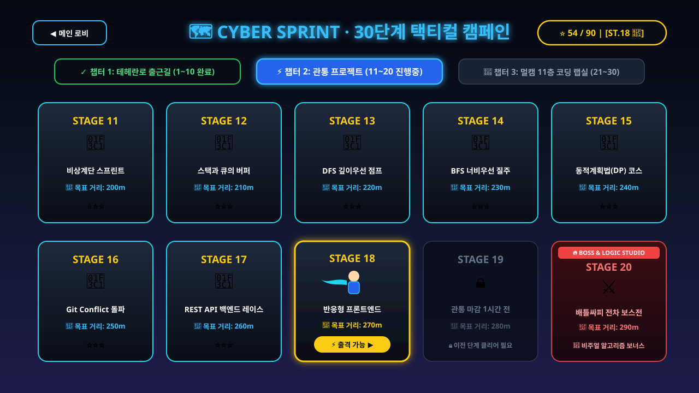
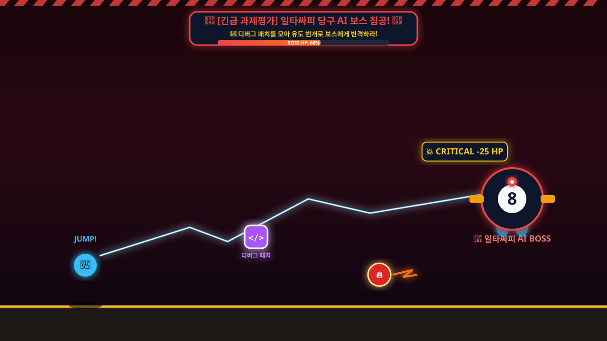
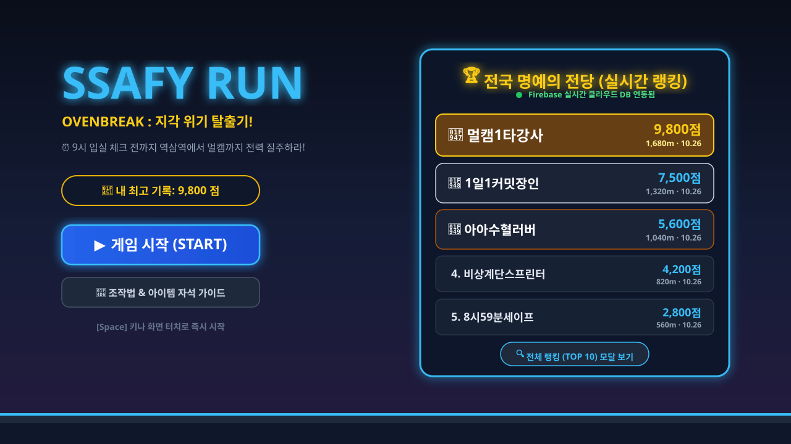
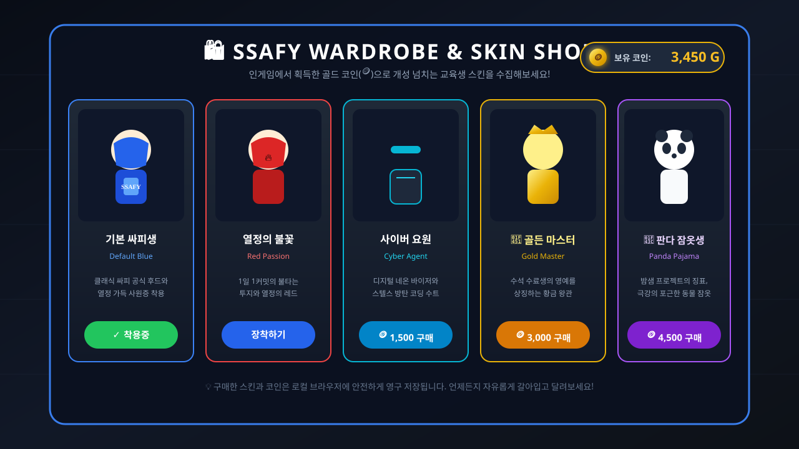

# 🏃‍♂️ SSAFY RUN: OvenBreak

<div align="center">


[](https://phaser.io/)
[](https://www.typescriptlang.org/)
[](https://vitejs.dev/)
[](https://firebase.google.com/)
[](https://github.com/strongsun806/ssafy-run)
[](https://github.com/strongsun806/ssafy-run/actions)
[](https://opensource.org/licenses/MIT)

**싸피인을 위한 쿠키런 × 바운스볼 스타일 웹 횡스크롤 러닝 액션 게임**  
*30단계 순차 클리어 모드 · 일타싸피 & 배틀싸피 보스 배틀 · 실시간 전국 랭킹 단계 배지 · 스킨 상점*

[🎮 지금 즉시 웹에서 플레이하기 (GitHub Pages)](https://strongsun806.github.io/ssafy-run/) · [🐛 버그 제보](https://github.com/strongsun806/ssafy-run/issues) · [💡 기능 제안](https://github.com/strongsun806/ssafy-run/issues)

</div>

---

## 📸 게임 플레이 & 시스템 시연 (Gameplay Demonstration)

<div align="center">

### 🗺️ 1. 30단계 바운스볼 스타일 스테이지 로드맵 (Stage Mode)
> **1단계부터 30단계까지 점점 어려워지는 3개 챕터 로드맵! 단계별 별점(⭐⭐⭐) 수집과 🏁 도착 관문 돌파!**



<br/>

### 🧩 2. 중간 쉬어가는 힐링 타임! 일타싸피 & 배틀싸피 블록코딩 평가 (Block Coding Break Time)
> **지친 손가락을 잠시 쉬어가는 힐링 인터미션! 🧠 블록을 조립하여 알고리즘을 컴파일하고, 멘탈(HP) 100% 완전 회복 & 골든 피버로 질주하세요!**


<br/>

### 🎱 3. 싸피 시그니처 평가 보스전: 일타싸피 & 배틀싸피 (Boss Battle)
> **당구대 쿠션 반사 궤적의 당구공과 장갑차 포탄 난사! 💊 디버그 패치를 모아 강력한 반격 빔을 발사하세요!**



<br/>

### 🎮 4. 인게임 하이퍼 러닝 액션 (In-Game Action)
> **바닥 구덩이(GAP)와 드론 구출, 2층 공중 발판, 🧲 일시적 자석 파워업과 2단 점프 액션!**


<br/>

### 🏆 5. 실시간 전국 명예의 전당 & 단계 배지 (Live Leaderboard)
> **어떤 환경에서 플레이해도 Firebase를 통해 전국 교육생의 최고 돌파 단계 `[ST.30 👑]`와 점수가 실시간 연동됩니다.**



<br/>

### 🛍️ 6. 교육생 캐릭터 스킨 상점 & 코인 경제 (Wardrobe & Shop)
> **인게임에서 모은 골드 코인(🪙)으로 개성 넘치는 5종 스킨을 해금하고 커스텀 외형으로 질주하세요!**



</div>

---

## 📖 시놉시스 (Story)

> **"오전 8시 50분, 역삼역 3번 출구... 출석 체크 마감까지 남은 시간은 단 10분!**  
> **1층 엘리베이터 앞은 이미 인산인해, 비상계단 문은 저 멀리 보인다.**  
> **쏟아지는 컴파일 에러와 머지 컨플릭트를 뚫고, 30개의 험난한 과제를 클리어하여 9시 입실 체크 QR을 찍어라!"**

**SSAFY RUN**은 SSAFY(삼성청년SW아카데미) 교육생들의 일상과 도전 과제들을 쿠키런 스타일의 역동적인 조작감과 바운스볼 특유의 단계별 도전 욕구로 승화시킨 웹 횡스크롤 러닝 액션 게임입니다.

---

## 🌟 핵심 게임 모드 및 최신 시스템

### 1. 🗺️ 30단계 순차 클리어 모드 (Bounce Ball Style Progression)
바운스볼처럼 1번 맵부터 30번 맵까지 단계적으로 클리어하며 점점 높은 난이도에 도전하는 모드입니다:
- **Chapter 1. 테헤란로 출근길 (STAGE 1 ~ 10)**:
  - 기초 조작과 기본 장애물(에러 모니터, 깃 충돌) 적응
  - 거리: 100m ~ 190m | 기본 속도: 380 ~ 420 px/s
  - **FINAL BOSS (Stage 10)**: 🎱 **일타싸피 당구공 보스 출현!**
- **Chapter 2. 비상계단 & 엘리베이터 지옥 (STAGE 11 ~ 20)**:
  - 좁은 발판 점프, 바닥 구덩이 낭떠러지, 속도 증가
  - 거리: 200m ~ 290m | 기본 속도: 430 ~ 490 px/s
  - **FINAL BOSS (Stage 20)**: ⚔️ **배틀싸피 중무장 전차 보스 출현!**
- **Chapter 3. 멀캠 11층 미래 코딩 랩실 (STAGE 21 ~ 30)**:
  - 극한의 반사신경 요구, 연속 공중 발판, 스피드 폭주
  - 거리: 300m ~ 420m | 최고 속도: 500 ~ 570 px/s
  - **SPECIAL BOSS (Stage 28, 29)**: 일타싸피 & 배틀싸피 연속 습격
  - **FINAL CLEAR (Stage 30)**: 🎓 **SSAFY 최종 수료식 🏁 캠퍼스 도착 관문 돌파!**
- **별점(Star Rating) 평가 시스템**:
  - 남은 체력(HP) 비율에 따라 스테이지별 ⭐ / ⭐⭐ / ⭐⭐⭐ 획득!
  - 로컬 브라우저에 최고 기록 및 해금 상태가 영구 보존됩니다.

---

### 2. 🧩 일타싸피 & 배틀싸피 중간 쉬어가는 블록코딩 평가 (Block Coding Intermission)
지친 손가락을 잠시 쉬어갈 수 있도록, 스테이지 10(일타싸피), 스테이지 20(배틀싸피) 및 랭킹런 주요 구간 진입 시 **블록코딩 평가 세션**이 열립니다:
- **🎱 일타싸피 (Billiards AI Block Coding)**:
  - `[📐 조준 각도: 45°]`, `[🔄 쿠션 반사 연산]`, `[⚡ 타구 파워: 80%]`, `[🎱 큐대 샷 발사!]` 블록을 순서대로 조립!
  - 실행(Run) 시 큐대가 공을 타격하고, 쿠션 반사를 거쳐 목적구가 🎯 홀컵으로 빨려 들어갑니다.
- **⚔️ 배틀싸피 (Cyber Tank AI Block Coding)**:
  - `[🚀 전진 2칸 이동]`, `[🔄 포탑 우회전 90°]`, `[📡 레이더 락온 조준]`, `[💥 주포 철갑탄 발사!]` 블록 조립!
  - 실행(Run) 시 전차가 이동 및 회전하여 적 보스 전차를 💥 일격에 격파합니다.
- **편의 기능 & 풍성한 보상**:
  - `[💡 정답 자동배치]`: 누구나 클릭 한 번으로 손쉽게 정답 블록을 자동 완성하여 연출을 즐길 수 있습니다.
  - `[⚡ 즉시 패스]`: 스피드런을 원하는 유저를 위한 즉시 통과 지원.
  - **클리어 보상**: **멘탈(HP) 100% 완전 회복** + **🪙 코인 +30개** + **점수 +5,000점** + **7초간 골든 피버 무적 질주**!

---

### 3. 🏆 실시간 전국 명예의 전당 & 단계 배지 (`[ST.30 👑]`)
- **실시간 Firebase 연동**: 전국 모든 캠퍼스의 플레이어 점수 및 최고 도달 단계가 실시간으로 기록됩니다.
- **클리어 단계 실시간 표시**:
  - `[ST.30 👑]`: 30단계 올클리어 마스터 교육생
  - `[ST.25]`, `[ST.18]`, `[ST.10]`: 각 유저가 돌파한 최고 스테이지가 랭킹 보드에 닉네임과 함께 영광스럽게 표시됩니다.
- **메인 메뉴 상시 노출**: 게임을 시작하기 전 메인 로비에서 실시간 전국 TOP 5의 위엄을 즉시 확인할 수 있습니다.

---

### 4. 🛍️ 코인 경제 & 5종 캐릭터 스킨 상점
달리면서 모은 골드 코인(🪙)으로 개성 넘치는 스킨을 구매하고 장착할 수 있습니다:
1. 🟦 **기본 싸피생 (Default Blue)**: 클래식 블루 후드 & 사원증 [기본 지급]
2. 🟥 **열정의 불꽃 (Red Passion)**: 1일 1커밋의 투지를 담은 레드 에디션 (600 코인)
3. ⬛ **사이버 요원 (Cyber Agent)**: 네온 바이저 & 스텔스 코딩 수트 (1,500 코인)
4. 👑 **골든 마스터 (Gold Master)**: 수석 수료생의 순금 왕관 에디션 (3,000 코인)
5. 🐼 **판다 잠옷생 (Panda Pajama)**: 밤샘 해커톤의 귀여운 동물 잠옷 (4,500 코인)

---

### 5. 🕳️ 바닥 구덩이 & 드론 구출 & 일시적 자석
- **바닥 구덩이 (GAP)**: 낭떠러지 추락 시 30 HP 데미지를 입지만 드론이 신속하게 날아와 선로로 구출해 줍니다.
- **2층 공중 발판**: 장애물이 많은 바닥을 피해 2층 발판으로 올라가 대량의 골드 코인을 획득할 수 있습니다.
- **일시적 자석 파워업 (6.5초)**: 자석 획득 시 전방의 잔디와 코인을 자동으로 시원하게 흡입합니다.

---

## 🎮 조작법 (Controls)

| 동작 | 데스크톱 키보드 | 모바일 / 터치 스크린 |
| :--- | :--- | :--- |
| **1단 점프 / 2단 점프** | `Space` 또는 `↑` / `W` 키 | **화면 우측 절반** 터치 (또는 JUMP 버튼) |
| **슬라이드 (숙이기)** | `↓` 또는 `S` 키 (길게 누르기) | **화면 좌측 절반** 터치 유지 (또는 SLIDE 버튼) |
| **공중 급강하 (Fast Fall)** | 공중에서 `↓` 또는 `S` 키 | 공중에서 **화면 좌측** 터치 |
| **일시 정지 (PAUSE)** | `P` 또는 `ESC` 키 | 화면 우측 상단 **❚❚** 버튼 터치 |
| **사운드 음소거 (Mute)** | 화면 우측 상단 🔊 아이콘 클릭 | 화면 우측 상단 🔊 아이콘 터치 |

---

## 🧩 인게임 아이템 & 오브젝트 도감

| 아이콘 | 명칭 | 유형 | 효과 및 획득 조건 |
| :---: | :--- | :---: | :--- |
| 🪙 | **골드 코인** | 재화 | **+50점 및 코인 +1** (상점 스킨 구매용) |
| 🌱 | **커밋 잔디** | 스코어 | **+100점** (15연속 획득 시 골든 피버 발동) |
| 🧲 | **자석 아이템** | 파워업 | **6.5초간 화면의 모든 코인/잔디를 강력 흡입** |
| 💊 | **디버그 패치** | 배틀 | **보스에게 즉각 카운터 빔 발사 (체력 -1 감소)** |
| ☕ | **아이스 아메리카노** | 회복 | **체력(HP) +25 즉시 회복** |
| ⚡ | **레드불 부스터** | 무적 | **5.5초간 초고속 무적 돌진 & 장애물 파괴** |
| 📱 | **입실 체크 QR** | 보너스 | **+300점** (높은 공중에 위치, 2단 점프로 획득) |
| ❌ | **500 에러 모니터** | 장애물 | 바닥 장애물 (점프로 뛰어넘기) |
| 🚧 | **머지 컨플릭트 배너** | 장애물 | 공중 장애물 (슬라이드로 통과) |
| 🕳️ | **바닥 구덩이 (GAP)** | 위험 지형 | 추락 시 30 HP 감소 후 드론 긴급 구출 |
| 🏁 | **도착 관문 (Gate)** | 스테이지 | 스테이지 모드 목표 거리 도달 시 통과하여 클리어 |

---

## 🛠 기술 스택 (Tech Stack)

```
┌────────────────────────────────────────────────────────┐
│                      SSAFY RUN                         │
└────────────────────────────────────────────────────────┘
          │                                  │
          ▼                                  ▼
┌──────────────────┐               ┌──────────────────┐
│  Client Engine   │               │ Cloud & Storage  │
│ ──────────────── │               │ ──────────────── │
│ • Phaser 3.80+   │               │ • Firebase RTDB  │
│ • TypeScript 5.7 │               │ • LocalStorage   │
│ • Web Audio API  │               │ • GitHub Pages   │
│ • Canvas 2D / GL │               │ • GitHub Actions │
└──────────────────┘               └──────────────────┘
```

- **Game Engine**: [Phaser 3](https://phaser.io/) (2D 캔버스 렌더링, 아케이드 물리 엔진, 씬 매니저)
- **Language**: [TypeScript 5.7](https://www.typescriptlang.org/) (엄격한 타입 안전성 및 상태 관리)
- **Bundler**: [Vite 6.3](https://vitejs.dev/) (초고속 HMR 및 최적화 빌드)
- **Cloud Database**: Google Firebase Realtime Database (전국 실시간 랭킹 REST API 연동)
- **Local Persistence**: Web LocalStorage (스테이지 30단계 진행도, 별점, 스킨, 코인 저장)
- **Audio Synthesis**: Web Audio API (외부 에셋 로딩 없이 실시간으로 합성되는 8비트 사운드 FX & BGM)
- **Automation / CI**: GitHub Actions (메인 브랜치 푸시 시 자동 배포)

---

## 🚀 로컬 개발 및 실행 (Getting Started)

```bash
# 1. 저장소 클론
git clone https://github.com/strongsun806/ssafy-run.git

# 2. 디렉토리 이동
cd ssafy-run

# 3. 의존성 설치
npm install

# 4. 로컬 개발 서버 구동
npm run dev
```

브라우저에서 `http://localhost:8080/`으로 접속하면 즉시 게임을 테스트할 수 있습니다.

```bash
# 프로덕션 빌드 테스트
npm run build-nolog
```

---

## 📜 라이선스 (License)

This project is licensed under the MIT License - see the [LICENSE](LICENSE) file for details.
