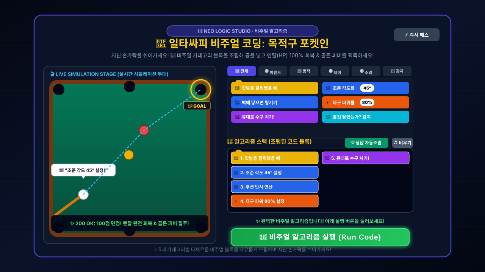
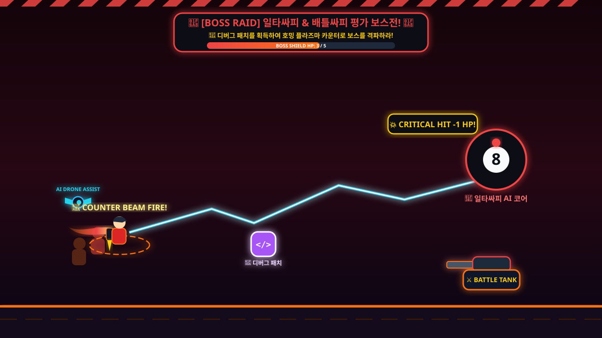
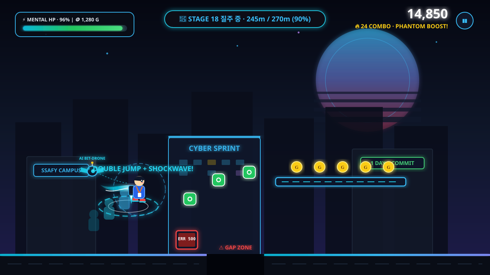
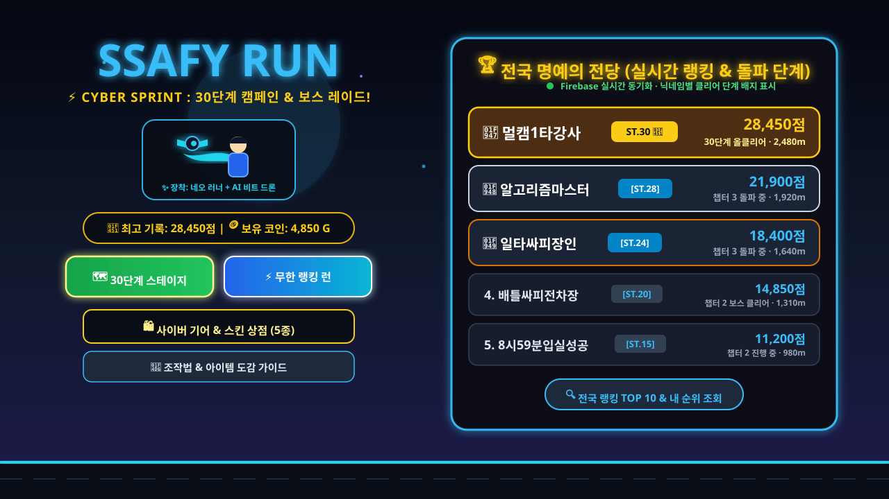
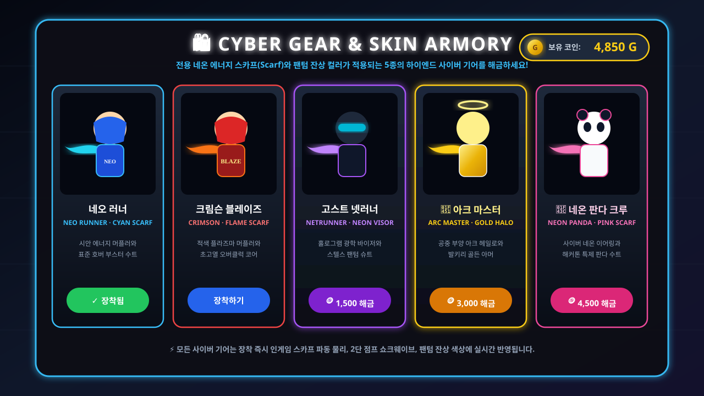

# ⚡ SSAFY RUN: CYBER SPRINT

<div align="center">


[](https://phaser.io/)
[](https://www.typescriptlang.org/)
[](https://vitejs.dev/)
[](https://firebase.google.com/)
[](https://github.com/strongsun806/ssafy-run)
[](https://github.com/strongsun806/ssafy-run/actions)
[](https://opensource.org/licenses/MIT)

**차세대 하이퍼 사이버펑크 횡스크롤 스피드런 액션 게임**  
*네온 스카프 & 팬텀 잔상 이펙트 · AI 비트 드론 펫 · 택티컬 30단계 캠페인 · 비주얼 알고리즘 스튜디오 · 실시간 전국 랭킹*

[🎮 지금 즉시 웹에서 플레이하기 (GitHub Pages)](https://strongsun806.github.io/ssafy-run/) · [📅 업데이트 히스토리 (Changelog)](CHANGELOG.md) · [🐛 버그 제보](https://github.com/strongsun806/ssafy-run/issues) · [💡 기능 제안](https://github.com/strongsun806/ssafy-run/issues)

</div>

---

## 📸 게임 플레이 & 시스템 시연 (Gameplay Demonstration)

<div align="center">

### 🗺️ 1. 택티컬 30단계 캠페인 로드맵 (Stage Campaign Mode)
> **1단계부터 30단계까지 점진적으로 고도화되는 3개 챕터 캠페인! 단계별 별점(⭐⭐⭐) 수집과 🏁 도착 관문 돌파!**


<br/>

### 🧩 2. 중간 쉬어가는 힐링 인터미션! 일타싸피 & 배틀싸피 비주얼 알고리즘 평가 (Visual Logic Studio)
> **지친 손가락을 잠시 쉬어가는 힐링 인터미션! 🧠 비주얼 노드를 조립하여 알고리즘을 컴파일하고, 멘탈(HP) 100% 완전 회복 & 골든 피버로 질주하세요!**



<br/>

### 🎱 3. 싸피 시그니처 평가 보스전: 일타싸피 & 배틀싸피 (Boss Raid Battle)
> **당구대 쿠션 반사 궤적의 당구공과 장갑차 포탄 난사! 💊 디버그 패치를 모아 강력한 반격 유도 빔을 발사하세요!**



<br/>

### 🎮 4. 인게임 하이퍼 사이버 러닝 액션 (In-Game Action)
> **휘날리는 네온 스카프와 AI 컴패니언 드론, 팬텀 잔상 이펙트, 2층 공중 발판, 🧲 자석 파워업과 360° 쇼크웨이브 2단 점프 액션!**



<br/>

### 🏆 5. 실시간 전국 명예의 전당 & 단계 배지 (Live Leaderboard)
> **어떤 환경에서 플레이해도 Firebase를 통해 전국 교육생의 최고 돌파 단계 `[ST.30 👑]`와 점수가 실시간 연동됩니다.**



<br/>

### 🛍️ 6. 하이엔드 캐릭터 기어 상점 & 코인 경제 (Cyber Gear & Wardrobe)
> **인게임에서 모은 골드 코인(🪙)으로 전용 네온 스카프와 헤드기어를 갖춘 5종 사이버 스킨을 해금하세요!**



</div>

---

## 📖 시놉시스 (Story)

> **"오전 8시 50분, 역삼역 3번 출구... 출석 체크 마감까지 남은 시간은 단 10분!**  
> **1층 엘리베이터 앞은 이미 인산인해, 비상계단 문은 저 멀리 보인다.**  
> **쏟아지는 컴파일 에러와 머지 컨플릭트를 뚫고, 30개의 험난한 과제를 클리어하여 9시 입실 체크 QR을 찍어라!"**

**SSAFY RUN: CYBER SPRINT**는 SSAFY(삼성청년SW아카데미) 교육생들의 치열한 일상과 알고리즘 도전 과제들을 스타일리시한 신스웨이브 네온 아트워크, 쾌감 넘치는 팬텀 잔상 이펙트, 그리고 전략적인 30단계 스테이지 캠페인으로 구현한 오리지널 웹 하이퍼 러닝 액션 게임입니다.

---

## 🌟 핵심 게임 모드 및 최신 시스템

### 1. ✨ 하이엔드 사이버펑크 그래픽 & AI 컴패니언 드론
스팀(Steam) 인디 액션 게임 감성의 독창적인 프로시저럴 아트워크와 이펙트 엔진을 탑재했습니다:
- **네온 에너지 스카프 & 호버 제트팩**: 캐릭터의 주행 프레임과 점프/슬라이드 물리 상태에 맞춰 실시간 파동으로 휘날리는 사이버 머플러와 추진기 불꽃 연출
- **AI 컴패니언 비트 드론 (Companion Bit-Drone)**: 플레이어 후방 공중을 부유하며 함께 질주하는 자율형 AI 파트너 드론
- **사이버 팬텀 잔상 (Phantom Afterimage) & 쇼크웨이브**: 2단 점프, 슬라이드, 피버 질주 시 장착한 스킨의 고유 네온 컬러 잔상과 360도 파동 링 생성
- **신스웨이브 스카이라인**: 거대 사이버 문(Cyber Moon)과 홀로그램 전광판이 빛나는 멀티캠퍼스 야경 패럴랙스 스크롤링

---

### 2. 🗺️ 택티컬 30단계 스테이지 캠페인 (30-Stage Tactical Campaign)
1번 맵부터 30번 맵까지 단계적으로 클리어하며 점점 높은 난이도에 도전하는 정교한 레벨 디자인 모드입니다:
- **Chapter 1. 테헤란로 출근길 (STAGE 1 ~ 10)**:
  - 기초 조작과 기본 장애물(에러 모니터, 깃 충돌) 적응
  - 거리: 100m ~ 190m | 기본 속도: 380 ~ 420 px/s
  - **FINAL BOSS (Stage 10)**: 🎱 **일타싸피 당구공 보스 출현!**
- **Chapter 2. 비상계단 & 엘리베이터 지옥 (STAGE 11 ~ 20)**:
  - 좁은 발판 점프, 바닥 구덩이 낭떠러지, 속도 증가
  - 거리: 200m ~ 290m | 기본 속도: 430 ~ 490 px/s
  - **FINAL BOSS (Stage 20)**: ⚔️ **배틀싸피 중무장 전차 보스 출현!**
- **Chapter 3. 멀캠 11층 미래 코딩 랩실 (STAGE 21 ~ 30)**:
  - 극한의 반사신경 요구, 연속 공중 발판, 스피드 폭주
  - 거리: 300m ~ 420m | 최고 속도: 500 ~ 570 px/s
  - **SPECIAL BOSS (Stage 28, 29)**: 일타싸피 & 배틀싸피 연속 습격
  - **FINAL CLEAR (Stage 30)**: 🎓 **SSAFY 최종 수료식 🏁 캠퍼스 도착 관문 돌파!**
- **별점(Star Rating) 평가 시스템**:
  - 남은 체력(HP) 비율에 따라 스테이지별 ⭐ / ⭐⭐ / ⭐⭐⭐ 획득!
  - 로컬 브라우저에 최고 기록 및 해금 상태가 영구 보존됩니다.

---

### 3. 🧩 일타싸피 & 배틀싸피 비주얼 알고리즘 스튜디오 (Visual Logic Studio)
지친 손가락을 잠시 쉬어갈 수 있도록, 스테이지 10(일타싸피), 스테이지 20(배틀싸피) 및 랭킹런 주요 구간 진입 시 **비주얼 노드 기반 알고리즘 코딩 평가 세션**이 열립니다:
- **다채로운 5대 알고리즘 카테고리 분류**:
  - 🟡 **이벤트 (Events)**: `[🚩 실행 버튼을 클릭했을 때]` 시작 트리거(Trigger) 블록으로 알고리즘 개시
  - 🔵 **동작 (Motion)**: `[📐 조준 각도를 (45°)로 정하기]`, `[🔄 벽에 닿으면 튕기기]`, `[🚀 앞으로 (2칸) 이동하기]`, `[↪️ 우측으로 (90°) 회전]`
  - 🟠 **제어 (Control)**: `[⚡ 타구 파워를 (80%)로 설정]`, `[⏱️ 0.3초 포탑 안정화 대기]`
  - 🟣 **출력 및 사운드 (Output & Sound)**: `[🎱 큐대로 수구 치기!]`, `[💥 주포 철갑탄 1발 발사!]`, `[💬 "대사 말하기" 말풍선 출력]`, `[🔊 효과음 재생]`
  - 🔴 **센서 감지 (Sensing)**: `[🎯 목적구가 포켓에 닿았는가?]`, `[📡 적 보스 탱크 레이더 탐지 락온]`
- **실시간 시뮬레이션 인터랙션 연출**:
  - 코드 실행 시 조립된 블록들이 위에서부터 순서대로 하이라이트되며 단계별로 실행됩니다.
  - 우측 시뮬레이션 캔버스 위의 캐릭터와 당구공, 전차 위에 실시간 상태 말풍선(`💬 "원쿠션 궤적 연산!"`, `💬 "적 보스 전차 락온!"`)이 팝업됩니다.
- **편의 기능 & 풍성한 힐링 보상**:
  - `[💡 정답 자동조립]`: 누구나 원클릭으로 최적 알고리즘 스택을 완성하여 통쾌한 시뮬레이션을 즐길 수 있습니다.
  - `[⚡ 즉시 패스]`: 스피드런을 원하는 유저를 위한 즉시 통과 지원.
  - **클리어 보상**: **멘탈(HP) 100% 완전 회복** + **🪙 코인 +30개** + **점수 +5,000점** + **7초간 무적 골든 피버 러닝 발동**!

---

### 4. 🏆 실시간 전국 명예의 전당 & 단계 배지 (`[ST.30 👑]`)
- **실시간 Firebase 연동**: 전국 모든 캠퍼스의 플레이어 점수 및 최고 도달 단계가 실시간으로 기록됩니다.
- **클리어 단계 실시간 표시**:
  - `[ST.30 👑]`: 30단계 올클리어 마스터 교육생
  - `[ST.25]`, `[ST.18]`, `[ST.10]`: 각 유저가 돌파한 최고 스테이지가 랭킹 보드에 닉네임과 함께 영광스럽게 표시됩니다.
- **메인 메뉴 상시 노출**: 게임을 시작하기 전 메인 로비에서 실시간 전국 TOP 5의 위엄을 즉시 확인할 수 있습니다.

---

### 5. 🛍️ 코인 경제 & 5종 하이엔드 사이버 기어 상점
달리면서 모은 골드 코인(🪙)으로 고유한 스카프 컬러와 잔상 이펙트를 지닌 스킨을 구매하고 장착할 수 있습니다:
1. 🟦 **네오 러너 (Neo Runner)**: 시안 에너지 머플러 & 테크웨어 후드 [기본 지급]
2. 🟥 **크림슨 블레이즈 (Crimson Blaze)**: 적색 플라즈마 코어 & 초고속 부스터 수트 (600 코인)
3. ⬛ **고스트 넷러너 (Ghost Netrunner)**: 홀로그램 바이저 & 퍼플 팬텀 스텔스 기어 (1,500 코인)
4. 👑 **아크 마스터 (Arc Master)**: 공중 부양 골든 헤일로 & 발키리 아머 (3,000 코인)
5. 🐼 **네온 판다 크루 (Neon Panda Crew)**: 사이버 뱅글 & 해커톤 특제 판다 후드 (4,500 코인)

---

### 6. 🕳️ 바닥 구덩이 & 드론 구출 & 일시적 자석
- **바닥 구덩이 (GAP)**: 낭떠러지 추락 시 30 HP 데미지를 입지만 긴급 구출 드론이 신속하게 날아와 선로로 복귀시켜 줍니다.
- **2층 공중 발판**: 장애물이 많은 바닥을 피해 2층 발판으로 올라가 대량의 골드 코인을 획득할 수 있습니다.
- **일시적 자석 파워업 (6.5초)**: 자석 획득 시 전방의 잔디와 코인을 자동으로 시원하게 흡입합니다.

---

## 🎮 조작법 (Controls)

| 동작 | 데스크톱 키보드 | 모바일 / 터치 스크린 |
| :--- | :--- | :--- |
| **1단 점프 / 2단 점프** | `Space` 또는 `↑` / `W` 키 | **화면 우측 절반** 터치 (또는 JUMP 버튼) |
| **슬라이드 (숙이기)** | `↓` 또는 `S` 키 (길게 누르기) | **화면 좌측 절반** 터치 유지 (또는 SLIDE 버튼) |
| **공중 급강하 (Fast Fall)** | 공중에서 `↓` 또는 `S` 키 | 공중에서 **화면 좌측** 터치 |
| **일시 정지 (PAUSE)** | `P` 또는 `ESC` 키 | 화면 우측 상단 **❚❚** 버튼 터치 |
| **사운드 음소거 (Mute)** | 화면 우측 상단 🔊 아이콘 클릭 | 화면 우측 상단 🔊 아이콘 터치 |

---

## 🧩 인게임 아이템 & 오브젝트 도감

| 아이콘 | 명칭 | 유형 | 효과 및 획득 조건 |
| :---: | :--- | :---: | :--- |
| 🪙 | **골드 코인** | 재화 | **+50점 및 코인 +1** (상점 스킨 구매용) |
| 🌱 | **커밋 잔디** | 스코어 | **+100점** (15연속 획득 시 골든 피버 발동) |
| 🧲 | **자석 아이템** | 파워업 | **6.5초간 화면의 모든 코인/잔디를 강력 흡입** |
| 💊 | **디버그 패치** | 배틀 | **보스에게 즉각 카운터 빔 발사 (체력 -1 감소)** |
| ☕ | **아이스 아메리카노** | 회복 | **체력(HP) +25 즉시 회복** |
| ⚡ | **하이퍼 에너지 부스터** | 무적 | **5.5초간 초고속 무적 돌진 & 장애물 파괴** |
| 📱 | **입실 체크 QR** | 보너스 | **+300점** (높은 공중에 위치, 2단 점프로 획득) |
| ❌ | **500 에러 모니터** | 장애물 | 바닥 장애물 (점프로 뛰어넘기) |
| 🚧 | **머지 컨플릭트 배너** | 장애물 | 공중 장애물 (슬라이드로 통과) |
| 🕳️ | **바닥 구덩이 (GAP)** | 위험 지형 | 추락 시 30 HP 감소 후 드론 긴급 구출 |
| 🏁 | **도착 관문 (Gate)** | 스테이지 | 스테이지 모드 목표 거리 도달 시 통과하여 클리어 |

---

## 🛠 기술 스택 (Tech Stack)

```
┌────────────────────────────────────────────────────────┐
│               SSAFY RUN: CYBER SPRINT                  │
└────────────────────────────────────────────────────────┘
          │                                  │
          ▼                                  ▼
┌──────────────────┐               ┌──────────────────┐
│  Client Engine   │               │ Cloud & Storage  │
│ ──────────────── │               │ ──────────────── │
│ • Phaser 3.80+   │               │ • Firebase RTDB  │
│ • TypeScript 5.7 │               │ • LocalStorage   │
│ • Web Audio API  │               │ • GitHub Pages   │
│ • Canvas 2D / GL │               │ • GitHub Actions │
└──────────────────┘               └──────────────────┘
```

- **Game Engine**: [Phaser 3](https://phaser.io/) (2D 캔버스 렌더링, 아케이드 물리 엔진, 씬 매니저)
- **Language**: [TypeScript 5.7](https://www.typescriptlang.org/) (엄격한 타입 안전성 및 상태 관리)
- **Bundler**: [Vite 6.3](https://vitejs.dev/) (초고속 HMR 및 최적화 빌드)
- **Cloud Database**: Google Firebase Realtime Database (전국 실시간 랭킹 REST API 연동)
- **Local Persistence**: Web LocalStorage (스테이지 30단계 진행도, 별점, 스킨, 코인 저장)
- **Audio Synthesis**: Web Audio API (외부 에셋 로딩 없이 실시간으로 합성되는 8비트 사운드 FX & BGM)
- **Automation / CI**: GitHub Actions (메인 브랜치 푸시 시 자동 배포)

---

## 🚀 로컬 개발 및 멀티 브랜치 플레이테스트 (Playtest Branches)

이 저장소는 게임성 비교 및 단계별 플레이 테스트를 위해 **4개의 전용 브랜치**와 **인게임 실시간 모드 스위처**를 제공합니다:

| 브랜치 명칭 | 버전 컨셉 및 핵심 테스트 포인트 | 전환 명령어 |
| :--- | :--- | :--- |
| **`main`** / **`release/v2.0-ultimate`** | 🌟 **얼티밋 통합 에디션 (v1.6.0)**: 테크랩 스펙 강화 + AI 드론 자율 요격 + `[Shift]` 하이퍼 대시 + `S·S·A·F·Y` 보너스 피버 전체 포함 | `git checkout release/v2.0-ultimate` |
| **`feat/rpg-tech-lab`** | 🛡️ **RPG 성장 & 방어 에디션**: `[🔧 테크 랩]` Lv.1~10 스펙 강화, 육각 플라즈마 쉴드, AI 비트 드론 궤도 레이저 요격 중심 | `git checkout feat/rpg-tech-lab` |
| **`feat/arcade-hyper-dash`** | ⚡ **하이퍼 아케이드 속도전 에디션**: `[Shift]` 초음속 무적 대시 스킬 및 `S·S·A·F·Y` 5글자 알파벳 수집 보너스 피버 중심 | `git checkout feat/arcade-hyper-dash` |

> 💡 **팁**: 브랜치를 바꾸지 않고도 메인 로비 하단의 **`[🎮 테스트 모드 전환]`** 배지를 클릭하면 `얼티밋 통합` / `RPG 테크랩` / `아케이드 대시` 모드를 즉시 전환하며 플레이 테스트할 수 있습니다!

```bash
# 1. 저장소 클론
git clone https://github.com/strongsun806/ssafy-run.git

# 2. 디렉토리 이동 및 원하는 테스트 브랜치 체크아웃
cd ssafy-run
git checkout release/v2.0-ultimate

# 3. 의존성 설치 및 로컬 플레이테스트 서버 실행
npm install
npm run dev
```

브라우저에서 `http://localhost:8080/`으로 접속하면 즉시 게임을 테스트할 수 있습니다.

```bash
# 프로덕션 빌드 테스트
npm run build-nolog
```

---

## 📅 주요 버전별 업데이트 내역 (Release History)

날짜별 상세 변경 사항 및 패치 로그는 [CHANGELOG.md](CHANGELOG.md)에서 전체 확인하실 수 있습니다.

| 버전 | 일자 | 주요 업데이트 내용 |
| :---: | :---: | :--- |
| **v1.5.0** | 2026-10-28 | ✨ CYBER SPRINT 그래픽 리마스터 (네온 스카프, AI 비트 드론 펫, 팬텀 잔상, 신스웨이브 야경) 및 독자 브랜드 표준화 |
| **v1.4.0** | 2026-10-28 | 🧩 비주얼 알고리즘 스튜디오 (5대 카테고리 탭, 13종 노드 블록, 실시간 대사 말풍선 미니게임) 고도화 |
| **v1.3.0** | 2026-10-28 | 🗺️ 택티컬 30단계 순차 클리어 캠페인 모드, 별점(⭐⭐⭐) 시스템, 실시간 랭킹 `[ST.30 👑]` 단계 배지 연동 |
| **v1.2.0** | 2026-10-28 | 🎨 바닥 어지러움 개선, 싸피 보스전(일타싸피/배틀싸피) 및 디버그 패치 반격, 피격 화면 이탈 버그 픽스 |
| **v1.1.0** | 2026-10-26 | 🏃‍♂️ 하이퍼 러닝 고도화 (바닥 구덩이 & 드론 구출, 2층 발판, 자석 파워업, 5종 캐릭터 스킨 상점, 전국 랭킹) |
| **v1.0.0** | 2026-10-26 | 🚀 완성형 횡스크롤 러너 배포, 절차적 8비트 사운드 FX, GitHub Pages 자동 배포 CI/CD 파이프라인 |

---

## 📜 라이선스 (License)

This project is licensed under the MIT License - see the [LICENSE](LICENSE) file for details.
